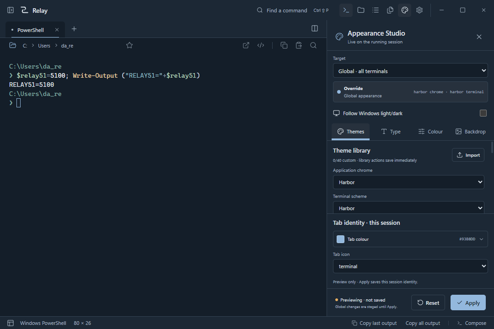

# Relay Terminal

**A real PowerShell terminal, with the bits I kept wishing were in the same window.**

**Windows · Tauri 2 · Rust/ConPTY · React/TypeScript · xterm.js · v5.1.1**

Relay Terminal 5.1.1 refines the approved Appearance Studio scope handoff: workspace edits keep the workspace palette when a session override is active. Windows release artifacts, release notes, validation report, and SHA-256 manifest are placed in [`Build/Release-5.1.1/`](Build/Release-5.1.1/) when packaged.

Download the [standalone Windows executable](https://github.com/aloosley-ux/Relay-Terminal/releases/download/v5.1.1/Relay-Terminal_5.1.1_x64.exe) or [NSIS installer](https://github.com/aloosley-ux/Relay-Terminal/releases/download/v5.1.1/Relay-Terminal_5.1.1_x64-setup.exe) from the [5.1.1 release](https://github.com/aloosley-ux/Relay-Terminal/releases/tag/v5.1.1). The [5.1.0 release](https://github.com/aloosley-ux/Relay-Terminal/releases/tag/v5.1.0) remains available.

[5.1.1 release notes](RELEASE-NOTES-5.1.1.md) · [5.1.1 validation](TEST-REPORT-5.1.1.md) · [5.1.0 release notes](RELEASE-NOTES-5.1.md) · [Appearance Studio guide](docs/APPEARANCE-STUDIO.md) · [4.0 release notes](RELEASE-NOTES-4.0.md)

Relay 5.1 keeps the approved Switchline identity and brings the unified Appearance Studio into the original `com.relay.terminal` product.

**Existing Windows taskbar pins:** Windows may keep showing a cached Relay 4.0 icon even when the installed 5.0 executable contains the correct Switchline icon. Run [the Windows shortcut-icon repair](scripts/repair-windows-shortcut-icons.ps1) to update the existing taskbar and Start menu shortcut icon paths without restarting Explorer. If Windows still shows the cached old image, unpin the old Relay taskbar entry and pin Relay Terminal again from Start. This is a Windows shortcut/icon-cache issue, not a reason to rebuild or redesign the release.

The editable VectorCraft and FigCraft originals remain under [`design/current/switchline-identity/`](design/current/switchline-identity/README.md). The approved and implemented Appearance Studio design remains editable under [`design/current/appearance-studio-5.1/`](design/current/appearance-studio-5.1/README.md).



Relay started as a personal replacement for juggling ConEmu tabs, project folders, commands and local development services. Instead of building another dashboard that *looks* like a terminal, it runs actual PowerShell sessions and gives them a workspace.

Relay opens into a floating terminal-first window. Its optional navigator, terminal-only mode and Appearance Studio keep supporting tools close without permanently reserving terminal space. The redesigned Studio edits five built-in themes, independent application/terminal palettes, global/workspace/session inheritance, every terminal and ANSI colour, typography, cursor, wallpaper, gradients and ambient effects. Live previews retain the running shells and scrollback. Right-click tabs, terminal surfaces and live workspace rows to reach contextual appearance controls.

> **The idea:** keep the terminal real, make common work easier to reach, and don't run a pile of background services just to draw a UI.

## A look around

| Workspace | What it actually does |
| --- | --- |
| **Terminal** | Multiple real PowerShell sessions, persistent while the app is open; named tabs, side-by-side splits, independent split appearances, search, copy/paste, working-directory tracking and saved commands. |
| **Projects** | Browse and pin local folders, discover Node and Cargo tasks, inspect Git branch/tracked changes, and open a project in its own terminal, Explorer or VS Code. |
| **Processes** | Observe Relay-owned tasks, existing local services and listening ports. Interrupt your own tasks; use explicit confirmations for supported external controllers. |
| **Files** | Search directory listings and preview bounded text files without leaving the terminal workspace. |

A command palette, keyboard shortcuts, Appearance Studio, saved actions and workspaces connect the four views. Tasks get named sessions; trying to launch the same running task again brings you back to it instead of quietly starting a duplicate.

Appearance Studio supports custom theme save/edit/rename/duplicate/delete with undo, portable import/export, Follow Windows, advisory contrast feedback, installed-font checks, and session tab color/Lucide identity. See the [complete user guide](docs/APPEARANCE-STUDIO.md) for scope and persistence behavior.

**This is a local-first tool.** There is no Relay account, telemetry, model running in the background, subscription or automatic service polling. Commands *you* choose to run can of course access the network, like they would in any terminal.

## What makes it different?

- **An actual shell.** Rust manages Windows ConPTY sessions and xterm.js renders the output. Your commands, environment and child processes are real.
- **No mystery automation.** Saved actions do not execute automatically; multiline paste is reviewed before it can run; live sessions ask before closing.
- **Useful to *my* setup, not just a mock-up.** Relay can read an existing Cortana controller and observe Remote Desktop Commander processes and logs. These are optional, machine-specific integrations — Relay doesn't install or own either system.
- **Quiet when idle.** Discovery runs on navigation or explicit refresh, rather than a permanent repository scanner or daemon.
- **Reproducible evidence.** The 5.1.1 release was exercised in the packaged Windows/WebView2 application, not just in browser previews or screenshots.

## Where it stands

**Relay is Windows-focused.** These are its current capabilities and boundaries. The v2.0 performance measurements below are historical samples; the [5.1.1 test report](TEST-REPORT-5.1.1.md) records the packaged-app checks and remaining verification limits.

| Works today | Still limited / not promised |
| --- | --- |
| Real interactive PowerShell tabs and split panes | Existing shell processes are **not** restored after restarting Relay; restored tabs start fresh shells. |
| Named tasks with output, elapsed time and interruption | Task discovery currently favours Node and Cargo; other projects can use manually entered commands. |
| Local files, projects, settings and actions | The file viewer is bounded plain text, not a full editor or binary viewer. |
| Cortana service actions through an existing local controller | Integrations depend on that controller being installed/configured; RDC lifecycle management is read-only. |
| Windows release EXE and NSIS installer | See the 5.1.1 test report for packaged GUI, icon-resource, and isolated installer checks. The release is unsigned; clean-machine validation remains a limitation. |
| Windows PowerShell tested end to end | PowerShell 7.6.7 and Windows PowerShell have native test coverage; Vim, cmd and Git Bash child workflows are exercised. Other applications are not exhaustively tested. |

A custom PowerShell prompt can also disable Relay's current-directory and outcome reporting; the terminal itself still functions.

For details, read [the 5.1.1 test report](TEST-REPORT-5.1.1.md) and [release notes](RELEASE-NOTES-5.1.1.md).

## How it was made

**This was built with AI-assisted software development.** I defined the problem, directed the workflows and iterations, and used AI coding agents to help research, implement, debug and test it. I'm not going to describe every line as hand-written, or pretend prompting a prototype is the same as shipping working software.

The foundations are established tools, not a brand-new terminal engine:

| Layer | What Relay uses |
| --- | --- |
| Desktop application | **Tauri 2** and Windows **WebView2** |
| Native backend | **Rust**, `portable-pty` 0.9, Windows ConPTY and Job Objects |
| Interface | **React 19**, TypeScript, Vite, Lucide icons |
| Terminal view | **xterm.js 6** |
| Shell | Windows PowerShell, or PowerShell 7 when available |
| Testing | Rust tests, scripted GUI/native WebView2 tests and disposable settings profiles |

REA was used **selectively**, including passive inspection of Relay's own compiled WebView and narrow research into an installed ConEmu binary's published strings. That research informed workflows such as tabs and launch tasks; it did **not** supply ConEmu source, artwork or a copied terminal implementation. [Read the technical investigation](REA-FINDINGS.md).

Design and development also drew on public documentation for Windows Terminal/ConPTY, VS Code task discovery, xterm.js, Flow Launcher, Process Compose and Yazi. They're inspirations and references, not bundled proprietary components. The [release notes](RELEASE-NOTES-2.0.md) link to those sources.

**The test evidence matters more than the screenshots.** We caught real bugs in terminal flow control, shell prompts, task handling, resizing and process shutdown by exercising the application. That doesn't mean every workflow has been tested on every PC.

## Measured, not marketed

For the **10 October 2026** v2.0 release run on one Windows PC:

| Measurement | Observed |
| --- | ---: |
| Median warm launch to visible controls | **371 ms** |
| Median warm launch to PowerShell prompt | **1,221 ms** |
| Fresh one-session idle CPU | **0.273% of this machine** over ~10 seconds |
| Fresh aggregate private memory | **277.68 MiB** including descendant processes |
| Original GUI regression groups | **22 passed** |
| New v2.0 GUI acceptance groups | **16 passed** |
| Focused keyboard/error groups | **3 passed** |
| Rust tests | **6 passed** |

Those are **measured samples, not minimum-spec guarantees**. The full Windows WebView2 + PowerShell process tree consumes substantially more memory than the tiny Rust host process alone. [Methodology, caveats and test evidence](TEST-REPORT-2.0.md).

## Run Relay

This repository tracks the **source**, not personal test data or built executables.

On the development machine, the 5.1.1 release files live under `Build/Release-5.1.1/`:

- `Relay-Terminal_5.1.1_x64.exe` — standalone Windows executable.
- `Relay-Terminal_5.1.1_x64-setup.exe` — NSIS installer.

The folder also contains release notes, the validation report and `SHA256SUMS.txt`. Generated executables are excluded from Git history.

Relay requires Windows 10 (1809+) or Windows 11 and Microsoft Edge WebView2. The NSIS installer uses Microsoft's WebView2 bootstrapper when the runtime is missing, so installation then requires an internet connection. Windows PowerShell is available by default; PowerShell 7 is used when installed. The release is currently unsigned.

## Build from source

You need Node.js/npm, Rust with the Windows MSVC toolchain, Visual Studio C++ build tools and WebView2.

```powershell
npm install
powershell -NoProfile -File scripts/build.ps1
```

For development:

```powershell
npm run desktop
```

The build script handles locating the standard Cargo binary directory. No cloud account or API key is required to build Relay.

## Data, permissions and safety

Settings, favourites, saved actions and tab/workspace definitions live at:

`%APPDATA%\com.relay.terminal\settings.json`

Relay does not edit your PowerShell profile to make shell integration work. Closing a live session terminates its contained child-process tree after confirmation. An action or command you explicitly run has the normal permissions of your Windows user; **Relay is not a security sandbox**.

Cortana integration invokes the existing local service controller when configured and selected. RDC remains observational because Relay has no verified local controller for its lifecycle. There is no regular background polling of either service.

Generated builds, logs, machine-specific settings, benchmark profiles and screenshots are excluded from version control.

## What's next?

No fake percentage-complete badge, no grand promises. The obvious next steps are cleaner onboarding away from the original machine, more portable project/task discovery, fuller keyboard/accessibility work, additional shell testing, and clean-PC installer verification.

The approved Appearance Studio is implemented in 5.1. Earlier competing design concepts remain historical references; see the design package status for details.

## Source, license and attribution

This is an **independent personal project**, built openly about its methods. Being visible in a Git repository does not automatically make it open source: **no redistribution license has been selected yet**. Third-party dependencies retain their own licenses.

Relay is not affiliated with ConEmu, Microsoft, ArtCraft or the other projects referenced above. Their product names are used descriptively; no proprietary source or assets have been copied into Relay.

---

*Built because I wanted to use it. Improved by testing what actually happens, not what the UI claims to do.*
